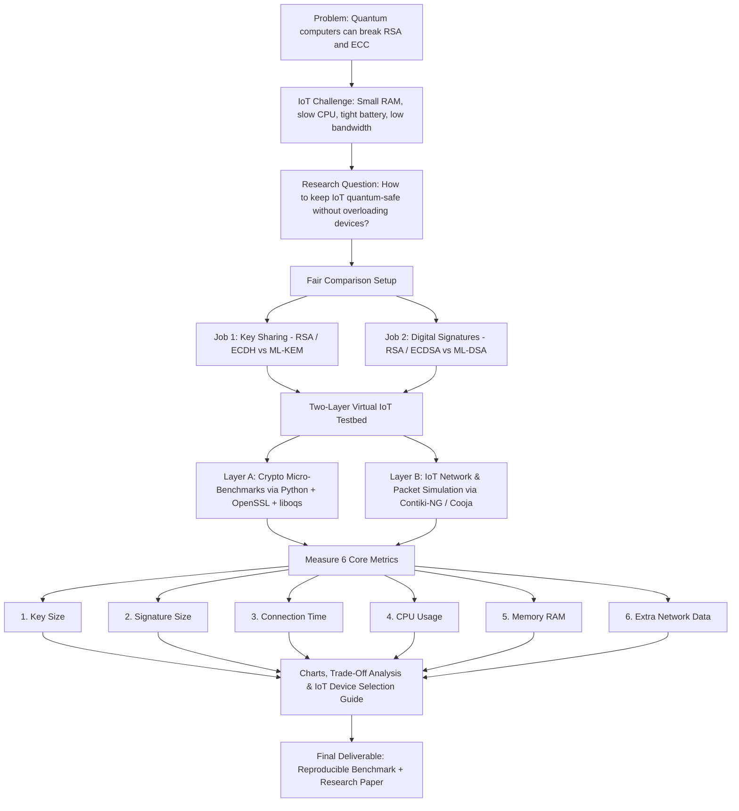
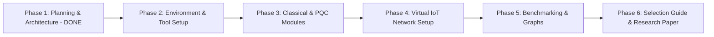

# Post-Quantum Cryptography for Secure IoT Communication

> **Project Status:** **Phase 1 — Planning & Architecture** *(Structured project plan, system architecture, benchmarking methodology, and module blueprints — implementation not started yet)*
>
> **Research Paper Title:** *Performance Evaluation of Post-Quantum Cryptographic Mechanisms for Secure IoT Communication*

---

## The Big Idea in Simple Words

Every day, smart devices (**IoT devices** such as smart cameras, environmental sensors, wearables, and smart appliances) send sensitive data over wireless networks. To keep that data private and authentic, they use **cryptography** — putting a digital lock on messages so only the intended receiver can open and trust them.

1. **Today's Locks (`RSA` and `ECC`):** Protect normal traffic effectively because classical computers cannot solve their underlying math quickly.
2. **Tomorrow's Threat (Quantum Computers):** Future large-scale quantum computers can run **Shor's algorithm** to break `RSA` and `ECC`. Even today, attackers can **record encrypted data now and decrypt it later** once quantum computers mature.
3. **New Quantum-Safe Locks (`PQC`):** **Post-Quantum Cryptography** uses new mathematical problems (such as structured lattices) that run on **ordinary computers and IoT devices**, yet resist both classical and quantum attacks. In 2024, NIST finalized **ML-KEM** (FIPS 203, for key sharing) and **ML-DSA** (FIPS 204, for digital signatures).
4. **The IoT Challenge:** Constrained IoT devices have **limited RAM, slow processors, tight battery budgets, and low-bandwidth radio links**. Because PQC keys and signatures are significantly larger than `ECC` equivalents, deploying them naively can overload memory, networks, and battery life.
5. **Project Objective:** Evaluate classical algorithms (`RSA`, `ECC`) fairly against post-quantum algorithms (`ML-KEM`, `ML-DSA`) inside a virtual IoT evaluation environment across **6 core metrics**, and produce a **practical IoT device-tier selection guide**.

---

## Master Project Flowchart



---

## Fair Comparison at a Glance (Same Job vs Same Job)

Comparing a **key-sharing algorithm** directly against a **digital-signature algorithm** would be misleading because they solve completely different problems. This study strictly evaluates algorithms performing the **same cryptographic role** at **equivalent security strengths**:

| Security Job | What It Does in Simple Words | Classical Baseline (Not Quantum-Safe) | Post-Quantum Standard (NIST 2024) |
| :--- | :--- | :--- | :--- |
| **Job 1: Key Sharing** *(Key Exchange / KEM)* | Lets two devices safely establish the same secret session key over an open network | **RSA** (Key Transport) & **ECC** (`ECDH`) | **ML-KEM** *(formerly Kyber — FIPS 203)* |
| **Job 2: Digital Signatures** *(Authentication)* | Proves sender identity and guarantees message integrity | **RSA** (Signing) & **ECC** (`ECDSA`) | **ML-DSA** *(formerly Dilithium — FIPS 204)* |

---

## Project Roadmap (6 Phases)



---

## Repository Structure & Reading Guide

> **Note:** Only planning documentation and directory blueprints are present right now. Directories such as `src/`, `configs/`, `data/`, `results/`, and `paper/` contain `README.md` specifications describing planned modules prior to Phase 2–3 implementation.

```text
CNN-pqc/
├── README.md                          # Master overview, architecture summary & navigation
├── .gitignore                         # Ignores build artifacts, Python cache, and temp logs
├── docs/                              # Structured project planning docs & diagrams
│   ├── 01_PROJECT_UNDERSTANDING.md    # Problem statement, quantum threat, IoT constraints, scope
│   ├── 02_CRYPTO_ALGORITHMS_GUIDE.md  # RSA, ECC, ML-KEM, ML-DSA explained + fair security tiers
│   ├── 03_ARCHITECTURE_AND_WORKFLOW.md# Two-layer testbed design, tools, and execution workflow
│   ├── 04_BENCHMARK_AND_METRICS_PLAN.md # 6 core metrics, experimental controls, IoT device tiers
│   ├── 05_IMPLEMENTATION_ROADMAP.md   # Phase-by-phase schedule, workstreams, Git workflow
│   └── 06_TECHNICAL_FAQ.md            # Key design decisions & technical Q&A in plain English
├── src/                               # [Planned] Cryptographic wrappers & simulation code
│   ├── classical/                     # [Planned] RSA, ECDH, ECDSA wrappers
│   ├── pqc/                           # [Planned] ML-KEM, ML-DSA wrappers (liboqs)
│   ├── network_sim/                   # [Planned] Contiki-NG / virtual IoT network setup
│   └── benchmark/                     # [Planned] Test runner, profiler & chart generator
├── configs/                           # [Planned] Algorithm & experiment YAML/JSON configs
├── data/                              # [Planned] Raw & aggregated CSV/JSON benchmark logs
├── results/                           # [Planned] Matplotlib graphs & device selection tables
└── paper/                             # [Planned] Research manuscript drafts & figures
```

### Documentation Index

1. **[01 — Project Understanding](docs/01_PROJECT_UNDERSTANDING.md):** Why quantum computers threaten `RSA`/`ECC`, why IoT devices struggle with heavier security, and explicit project scope boundaries.
2. **[02 — Crypto Algorithms Guide](docs/02_CRYPTO_ALGORITHMS_GUIDE.md):** Plain-language walkthrough and sequence diagrams for `RSA`, `ECC`, `ML-KEM`, and `ML-DSA`, plus verified NIST parameter sizes and security-level parity.
3. **[03 — System Architecture & Workflow](docs/03_ARCHITECTURE_AND_WORKFLOW.md):** End-to-end pipeline, tool stack rationale, and how `liboqs-python` integrates cleanly with `Contiki-NG`.
4. **[04 — Benchmark & Metrics Plan](docs/04_BENCHMARK_AND_METRICS_PLAN.md):** Measurement methodology for all 6 metrics, strict fairness controls, test scenarios, and IoT device-tier classification.
5. **[05 — Implementation Roadmap](docs/05_IMPLEMENTATION_ROADMAP.md):** Six-phase build schedule, module workstreams, and Git branching/commit standards.
6. **[06 — Technical FAQ](docs/06_TECHNICAL_FAQ.md):** Clear, concise explanations of common architectural questions and cryptographic trade-offs.
