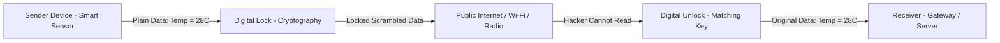
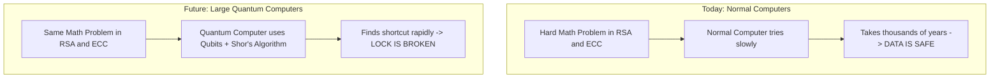
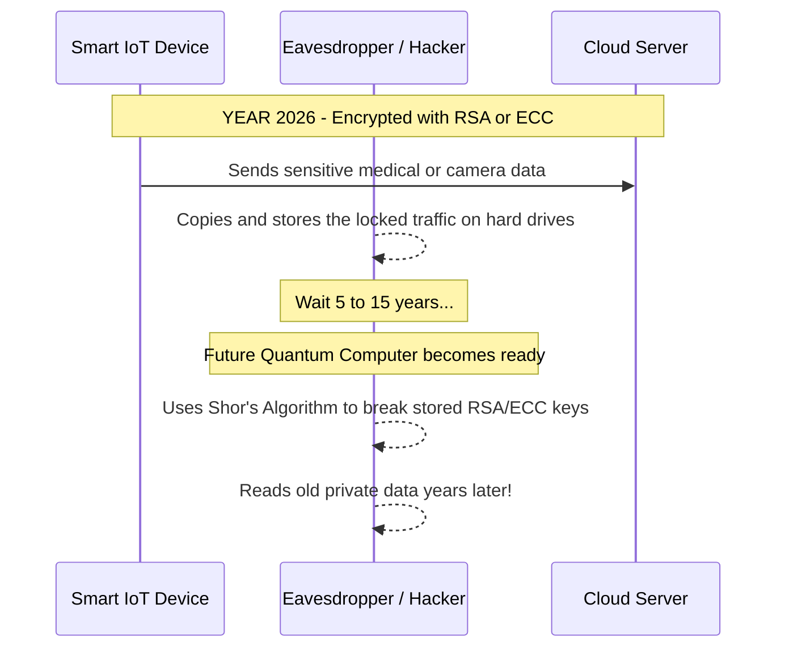
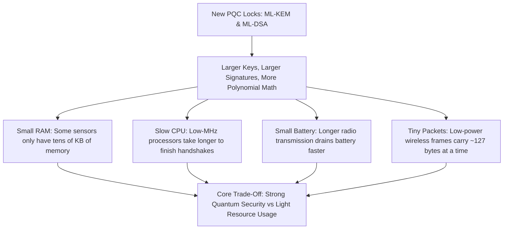
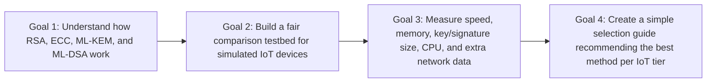

# 01 — Project Understanding: Why Quantum-Safe IoT Security Matters

> **Purpose of this document:** Explain the entire research problem, motivation, IoT constraints, and project boundaries in **plain, simple language** supported by clear diagrams.

---

## 1. What is Cryptography? (The Lock Analogy)

Think of sending a message on the internet like sending a postcard through the public mail: anyone handling the mail along the way could read it or change what is written on it.

**Cryptography** puts an unbreakable digital **lock** on the message before it leaves your device, so only the intended receiver with the matching **key** can unlock and read it.

---

## 2. How Today's Internet Locks Data (RSA and ECC)

Almost every secure connection today (websites with HTTPS, WhatsApp, online banking, smart home apps) starts with two traditional mathematical locks:

- **RSA (Rivest–Shamir–Adleman):** Hard to break because multiplying two giant prime numbers is easy, while **splitting the product back into those two primes** takes a normal computer thousands of years.
- **ECC (Elliptic Curve Cryptography):** Does the same security job using math on special curves, achieving equivalent protection with **much smaller keys** than RSA — which is why ECC is super popular on mobile and IoT devices today.

---

## 3. What Changes with Quantum Computers?

Normal computers store information as **bits** — each bit is strictly either `0` or `1`, so they test possibilities one step at a time.

**Quantum computers** use **qubits** (which can exist in combinations of `0` and `1` simultaneously, creating interference patterns). Using a famous quantum recipe called **Shor's algorithm**, a sufficiently large future quantum computer can solve the exact math problems behind **both RSA and ECC** rapidly.

### Why We Must Act NOW: "Harvest Now, Decrypt Later"

Even though huge quantum computers capable of breaking RSA-2048 do not exist publicly today, security researchers warn about a real threat happening **right now**:

For IoT devices deployed in hospitals, factories, smart grids, and cars that stay running for **10 to 15 years**, protecting them only *after* quantum computers arrive will be too late.

---

## 4. What is Post-Quantum Cryptography (PQC)?

**Post-Quantum Cryptography (PQC)** means designing **new digital locks** built on different math problems (such as **structured lattices** — finding the shortest path across a high-dimensional grid of points) that even **Shor's algorithm cannot break**.

> **Important Clarification (Common Myth):**
> Do devices need a quantum computer to run Post-Quantum Cryptography?
> **NO!** PQC algorithms run as normal software on **ordinary laptops, phones, servers, and IoT microcontrollers**. They are called "post-quantum" because they stay **safe against** quantum attacks, not because they *require* quantum hardware.

In **August 2024**, **NIST** (the U.S. National Institute of Standards and Technology) finalized the world's first official PQC standards, including:
- **ML-KEM** *(FIPS 203, formerly Kyber)* — for **key sharing**
- **ML-DSA** *(FIPS 204, formerly Dilithium)* — for **digital signatures**

---

## 5. Why IoT Devices Make PQC Challenging

A laptop or cloud server has gigabytes of RAM, fast multi-core CPUs, and wall power. An **IoT device** (like a smart bulb, wearable fitness band, soil moisture sensor, or security camera) is completely different:

Because PQC keys and signatures are significantly larger than ECC keys and signatures, putting PQC blindly onto every tiny IoT gadget could cause:
- Memory crashes (running out of RAM)
- Slow connection setup (high handshake latency)
- Heavy network traffic and packet splitting (fragmentation overhead)
- Faster battery drain

---

## 6. Our Research Question & Goals

### Core Research Question
> *"How can we keep IoT devices safe from quantum attacks, without using too much memory, power, or battery?"*

### Four Specific Research Goals

1. **Learn & Map:** Clearly understand both classical (`RSA`, `ECC`) and post-quantum (`ML-KEM`, `ML-DSA`) mechanisms and map them by identical security jobs.
2. **Test Fairly:** Implement and compare them inside a controlled virtual IoT testbed under matched security levels.
3. **Measure Everything:** Collect reliable measurements across **6 concrete metrics** (Key Size, Signature Size, Connection Time, CPU Usage, RAM Memory, Extra Bandwidth Data).
4. **Guide Developers:** Produce practical charts and a clear **IoT Device-Tier Selection Guide** so engineers can balance security, speed, and device limits.

---

## 7. Project Scope Boundaries (What Is In vs Out)

Defining clear boundaries keeps the research focused, rigorous, and achievable within the planned project scope:

| Area | In Scope (What We WILL Do) | Out of Scope (What We Will NOT Do) |
| :--- | :--- | :--- |
| **Algorithms** | Classical `RSA`, `ECC` (`ECDH`, `ECDSA`) vs PQC `ML-KEM`, `ML-DSA` | Inventing brand-new cryptographic math or breaking NIST algorithms |
| **Environment** | Virtual / simulated IoT network (`Contiki-NG` + constrained Python/`liboqs`/OpenSSL testbed) | Buying expensive specialized quantum hardware or testing 20 different physical boards |
| **Security Focus** | Key sharing, digital signatures, and handshake/payload overhead | Side-channel physical power-probe hardware attacks (oscilloscope DPA/SPA) |
| **Deliverables** | Reproducible benchmark suite, visual Matplotlib graphs, selection guide, research paper | Full production firmware deployment on commercial smart home clouds |
