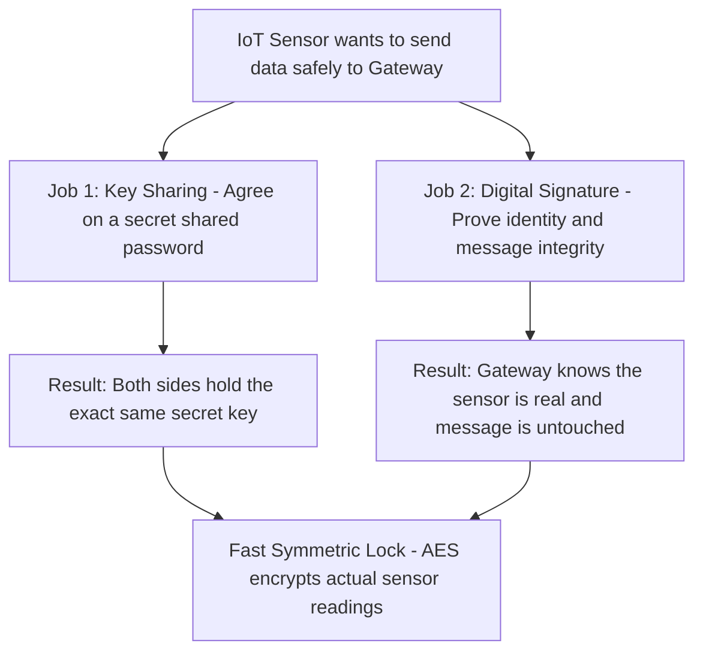
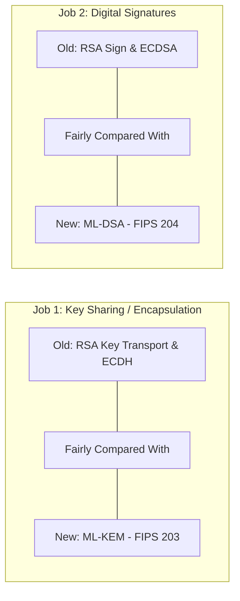
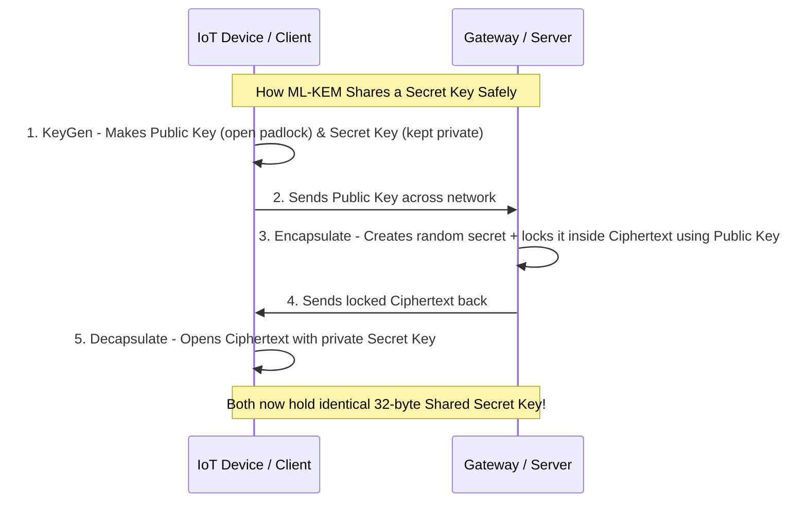
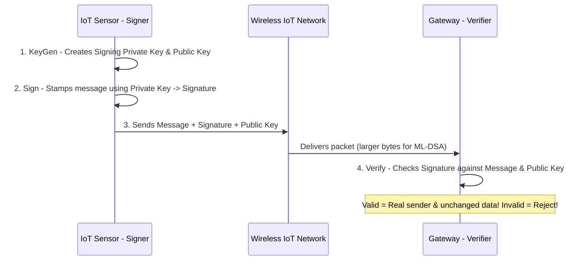
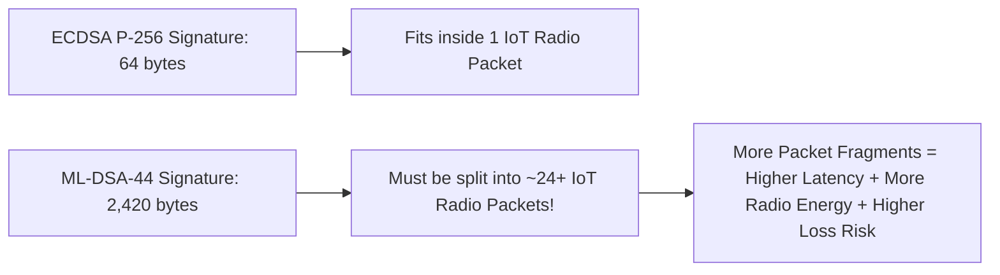

# 02 — Crypto Algorithms Guide: Old vs New & Fair Comparison Rules

> **Purpose of this document:** Explain **RSA**, **ECC**, **ML-KEM**, and **ML-DSA** in simple terms, show why they must be compared **job-to-job**, and record the official NIST parameter sizes that serve as our pre-experiment baseline.

---

## 1. Two Different Jobs in Every Secure Connection

When two IoT devices want to communicate securely, asymmetric cryptography performs **two completely separate jobs** before normal fast data encryption (like AES) takes over:

### The Golden Fairness Rule
> **Compare Key Sharing ONLY with Key Sharing, and Signatures ONLY with Signatures.**
> Comparing a key-exchange algorithm directly against a signature algorithm is meaningless — like comparing a padlock against a handwritten passport stamp.

Notice an important difference between old and new algorithms:
- **Old algorithms (`RSA` and `ECC`)** can be configured to do *both* jobs (though under different sub-protocols like `ECDH` vs `ECDSA`).
- **New PQC algorithms** split the two jobs into dedicated specialized standards:
  - **ML-KEM** = **ONLY Key Sharing**
  - **ML-DSA** = **ONLY Digital Signatures**

---

## 2. Job 1 Explained Simply: Key Sharing (`RSA` / `ECDH` vs `ML-KEM`)

### Plain-English Story
Imagine an IoT temperature sensor and a server shouting across a crowded room full of eavesdroppers. Somehow, they need to end up holding the **exact same secret password** without anyone listening learning what it is!

- **Traditional `ECDH` (Elliptic Curve Diffie-Hellman):** Both sides mix a secret number with a public curve point and exchange their public mixes. Using special curve math, both independently calculate the exact same shared secret.
- **Traditional `RSA` Key Transport:** Server sends its RSA public key; sensor picks a random secret, locks it with the server's RSA key, and sends it back.
- **Post-Quantum `ML-KEM` (Module-Lattice Key-Encapsulation Mechanism, formerly CRYSTALS-Kyber):** Works like a **quantum-safe digital lockbox**:

---

## 3. Job 2 Explained Simply: Digital Signatures (`RSA` / `ECDSA` vs `ML-DSA`)

### Plain-English Story
Even if a message is secret, how does the server know it came from **your trusted Door Lock Sensor** and NOT from a hacker pretending to be it, or from someone altering `"LOCKED"` into `"UNLOCKED"`?

A **Digital Signature** acts like a tamper-proof wax seal unique to the sender:
- **Traditional `RSA` Signing & `ECDSA`:** Uses the sender's private key to generate a mathematical stamp on the message hash; anyone with the sender's public key can verify it.
- **Post-Quantum `ML-DSA` (Module-Lattice Digital Signature Algorithm, formerly CRYSTALS-Dilithium):** Does the exact same verification job using lattice-based math so quantum computers cannot forge signatures.

---

## 4. Official Standard Parameter Sizes & Fair Equivalence Matching

To make our benchmark **scientifically fair**, we match algorithms by **equivalent security strength** (how hard they are to break, mapped to NIST Security Levels / symmetric AES bit strength).

> **Note on numbers below:** These byte sizes come from official **NIST SP 800-57**, **NIST FIPS 203 (ML-KEM)**, and **NIST FIPS 204 (ML-DSA)** specifications. They represent **known standard sizes** that our benchmark will verify and then combine with our **own experimental timing, RAM, CPU, and network measurements** in Phases 4–5.

### Table A — Job 1: Key Sharing Comparison Matrix

| Security Tier | Algorithm | Public Key Size | Ciphertext / Ephemeral PubKey Sent | Shared Secret | Quantum-Safe? |
| :--- | :--- | :---: | :---: | :---: | :---: |
| **Legacy Baseline** *(~112-bit)* | **RSA-2048** *(Key Transport)* | 256 bytes *(raw modulus)* | 256 bytes | 32 bytes *(derived)* | No |
| **Level 1** *(~128-bit)* | **RSA-3072** *(Key Transport)* | 384 bytes *(raw modulus)* | 384 bytes | 32 bytes *(derived)* | No |
| **Level 1** *(~128-bit)* | **ECC P-256** (`ECDH secp256r1`) | 65 bytes *(uncompressed)* | 65 bytes *(ephemeral pubkey)* | 32 bytes | No |
| **Level 1** *(~128-bit)* | **ML-KEM-512** *(FIPS 203)* | **800 bytes** | **768 bytes** | **32 bytes** | **Yes** |
| **Level 3** *(~192-bit)* | **ECC P-384** (`ECDH secp384r1`) | 97 bytes *(uncompressed)* | 97 bytes | 48 bytes | No |
| **Level 3** *(~192-bit)* | **ML-KEM-768** *(FIPS 203)* | **1,184 bytes** | **1,088 bytes** | **32 bytes** | **Yes** |
| **Level 5** *(~256-bit)* | **ML-KEM-1024** *(FIPS 203)* | **1,568 bytes** | **1,568 bytes** | **32 bytes** | **Yes** |

### Table B — Job 2: Digital Signatures Comparison Matrix

| Security Tier | Algorithm | Public Key Size | Signature Size | Private Key Size | Quantum-Safe? |
| :--- | :--- | :---: | :---: | :---: | :---: |
| **Legacy Baseline** *(~112-bit)* | **RSA-2048** *(PSS / PKCS#1)* | 256 bytes *(raw modulus)* | 256 bytes | ~1,192 bytes *(DER)* | No |
| **Level 1** *(~128-bit)* | **RSA-3072** *(PSS / PKCS#1)* | 384 bytes *(raw modulus)* | 384 bytes | ~1,768 bytes *(DER)* | No |
| **Level 1** *(~128-bit)* | **ECC P-256** (`ECDSA`) | 65 bytes *(uncompressed)* | 64 bytes *(raw)* / ~72 bytes *(DER)* | 32 bytes *(scalar)* | No |
| **Level 2** *(~128-bit+)* | **ML-DSA-44** *(FIPS 204)* | **1,312 bytes** | **2,420 bytes** | **2,560 bytes** *(or 32B seed)* | **Yes** |
| **Level 3** *(~192-bit)* | **ECC P-384** (`ECDSA`) | 97 bytes *(uncompressed)* | 96 bytes *(raw)* / ~104 bytes *(DER)* | 48 bytes *(scalar)* | No |
| **Level 3** *(~192-bit)* | **ML-DSA-65** *(FIPS 204)* | **1,952 bytes** | **3,309 bytes** | **4,032 bytes** *(or 32B seed)* | **Yes** |
| **Level 5** *(~256-bit)* | **ML-DSA-87** *(FIPS 204)* | **2,592 bytes** | **4,627 bytes** | **4,896 bytes** *(or 32B seed)* | **Yes** |

---

## 5. Why Byte Sizes Matter So Much on IoT Networks (Visual Intuition)

Look closely at the **Digital Signature** numbers above. On a normal Wi-Fi or fiber internet connection, sending 2,420 bytes takes almost zero noticeable time.

On a low-power IoT wireless network (such as **IEEE 802.15.4 / 6LoWPAN** used in Contiki-NG), **each radio packet can carry a maximum frame size of 127 bytes** (with roughly ~80–102 bytes left for payload after headers):

This single visual explains **why our project is needed**:
- Is `ML-KEM-512` (~800B key) fast and compact enough for small IoT nodes?
- Where does `ML-DSA-44` (~2,420B signature) start choking slow IoT links or draining batteries?
- Which exact IoT device class can handle pure PQC smoothly, and which needs lightweight tuning or gateway offloading?

Our planned experiments will answer these questions with hard numbers.
