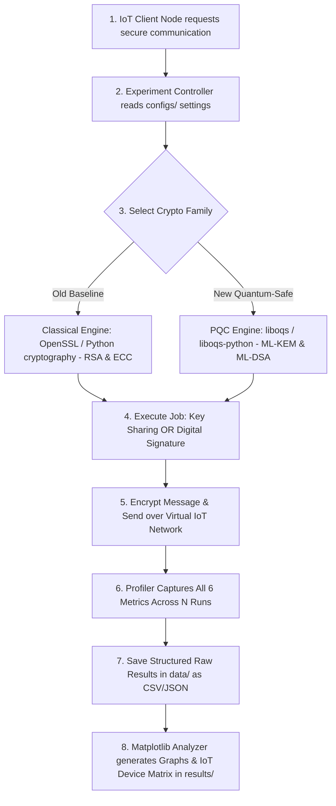
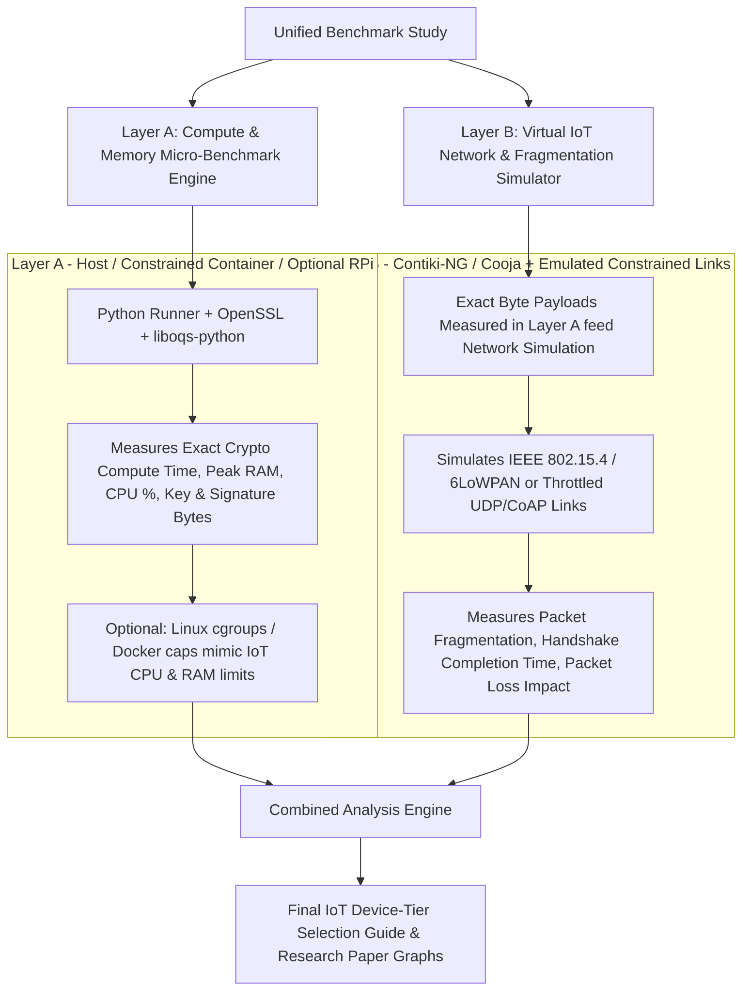
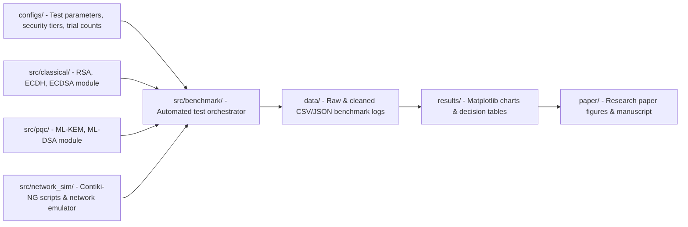
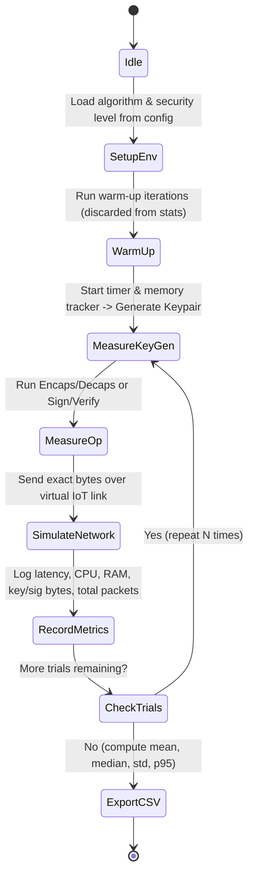

# 03 — System Architecture & Workflow Plan

> **Purpose of this document:** Lay out the exact technical blueprint of how our testing system will work, explain the planned tools in simple words, and clarify how **Python / `liboqs`** and **Contiki-NG** work together cleanly without architectural dead-ends.

---

## 1. High-Level System Workflow (From Device Request to Comparison Report)

This flowchart defines the end-to-end engineering pipeline from cryptographic selection to visual analysis:

---

## 2. Planned Tech Stack (Simple Tool-by-Tool Role)

| Tool | Plain-English Role | Why We Chose It |
| :--- | :--- | :--- |
| **Python 3** | Brain / coordinator that runs experiments, repeats tests, and logs timing/RAM | Easy to automate, readable across modules, rich tooling ecosystem |
| **OpenSSL / Python `cryptography`** | Provides trusted, industry-standard **RSA**, **ECDH**, and **ECDSA** | Fair, optimized baseline — avoids slow custom math scripts |
| **`liboqs` (`liboqs-python`)** | Open Quantum Safe library providing **ML-KEM** and **ML-DSA** | Official open-source C core with Python bindings supporting NIST FIPS 203 & 204 |
| **Contiki-NG (Cooja Simulator)** | Simulates constrained virtual IoT networks and low-power wireless packets | Lets us test IoT network conditions without buying dozens of hardware motes |
| **Linux Resource Controls / Docker / Optional Raspberry Pi** | Caps CPU/RAM or tests real ARM edge boards | Ensures software runs experience realistic IoT hardware limits |
| **Matplotlib (& Pandas)** | Turns raw CSV/JSON test logs into clear bar charts, boxplots, and trade-off graphs | Publication-ready figures for the research manuscript and summary reports |

---

## 3. Crucial Design Bridge: How `liboqs-python` and `Contiki-NG` Fit Together

A critical engineering question in this architecture is:
> *"Contiki-NG runs lightweight C code on tiny simulated microcontrollers, while `liboqs-python` runs in Python on Linux. How do those two tools connect?"*

Solving this upfront in our **Two-Layer Evaluation Architecture** ensures our implementation phase goes smoothly with zero surprises:

### Why This Two-Layer Design Is Smart
1. **Why not force all of `liboqs` + Python inside a tiny 32 KB Contiki mote?**
   `liboqs` is a general-purpose C library designed for desktop/server/SBC environments and does not fit unmodified inside ultra-tiny 10–32 KB microcontroller RAM, and Python cannot run on bare-metal sensor motes.
2. **How Layer A + Layer B give the FULL picture:**
   - **Layer A** gives **100% real, exact cryptographic execution numbers** (`RSA`, `ECC`, `ML-KEM`, `ML-DSA` via OpenSSL and `liboqs`) including compute latency, CPU %, RAM footprint, and exact serialized key/signature byte sizes. It can also be run on a constrained Docker container or a Raspberry Pi later!
   - **Layer B** uses **Contiki-NG / Cooja** (plus Linux `tc`/network namespaces if testing full IP handshakes) to show what happens when **those exact byte payloads** travel across a realistic, lossy, low-bandwidth IoT mesh network (packet fragmentation, airtime delay, handshake timeout).
   - *(Optional Stretch Goal in Phase 4/5)*: Test a lightweight C implementation (such as `PQClean` / `mupq` subset) directly in Contiki-NG's native/Cooja target for comparison!

---

## 4. Planned Data & Code Flow Across Repository Folders

---

## 5. Handshake Simulation State Flow (What One Benchmark Trial Looks Like)

Every single benchmark trial follows the same deterministic sequence to eliminate bias:

