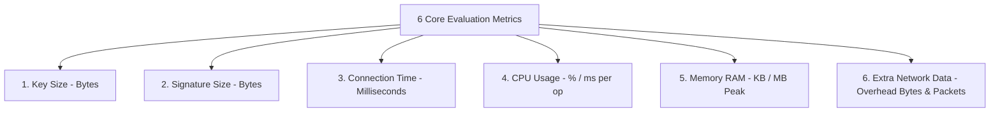
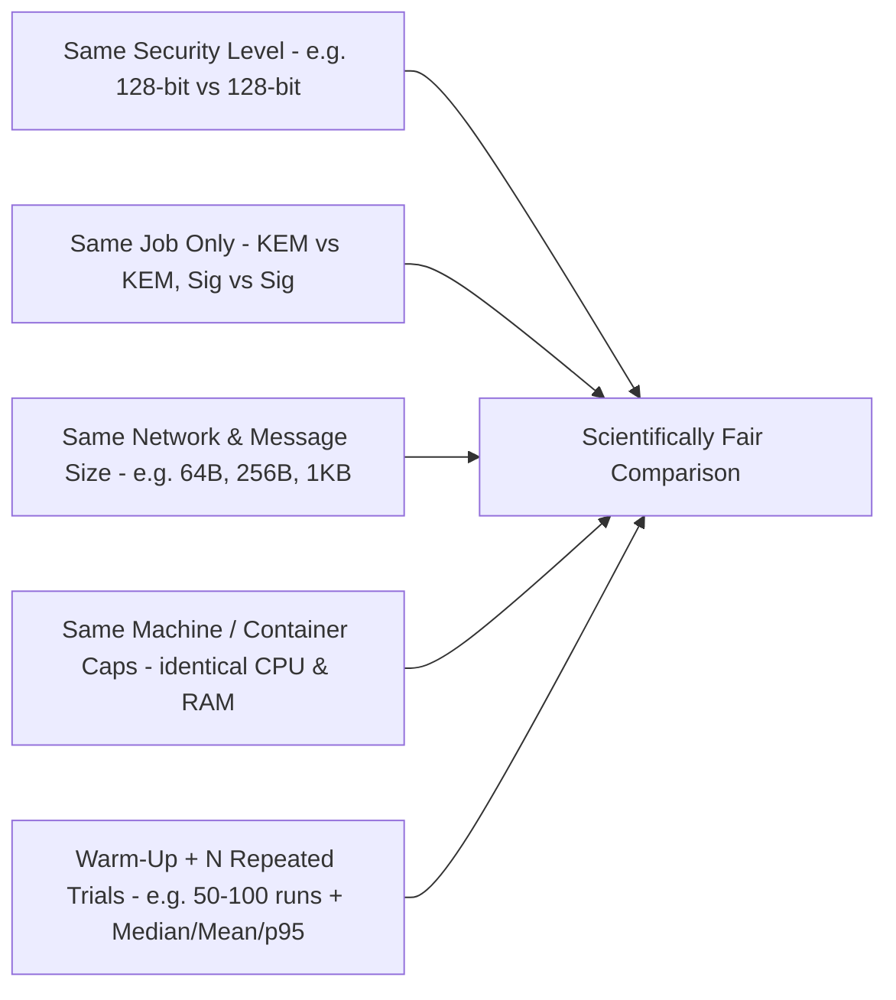
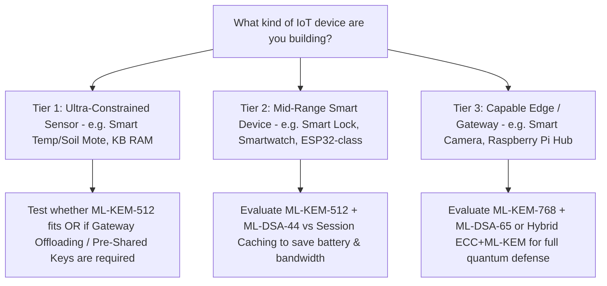

# 04 — Benchmark Plan, 6 Core Metrics & Device Selection Blueprint

> **Purpose of this document:** Define **what** we will measure, **how** we keep every comparison fair, **what scenarios** we will test, and **how** our results will turn into a practical guide for IoT developers.
>
> **Important Note:** We have **NOT run experiments yet**. Any expected trends mentioned below are *pre-experiment hypotheses* to verify during Phase 5.

---

## 1. The 6 Metrics We Will Measure (Simple Meanings & Units)

Every algorithm is evaluated across **6 concrete metrics** covering storage, compute, memory, and network impact:

| # | Metric | Simple Meaning | Unit | How We Plan to Measure |
| :-: | :--- | :--- | :---: | :--- |
| **1** | **Key Size** | How big the public & private keys (plus KEM ciphertext) are — larger keys need more flash/RAM storage | `Bytes` / `KB` | Exact byte length of serialized keys & ciphertexts from OpenSSL / `liboqs` |
| **2** | **Signature Size** | How big the digital proof stamp attached to a message is | `Bytes` / `KB` | Exact byte length of generated signature (`RSA`, `ECDSA`, `ML-DSA`) |
| **3** | **Connection Time** *(Handshake Latency)* | Total time taken for two IoT devices to set up a trusted secret session (`KeyGen + Exchange/Sign + Network Transit`) | `ms` | High-resolution timer (`time.perf_counter_ns()`) + simulated network RTT |
| **4** | **CPU Usage** | How hard the processor has to work during math operations | `%` / `ms CPU time` | Process CPU time (`time.process_time_ns()` / `psutil`) under fixed CPU quota |
| **5** | **Memory (RAM)** | Working space needed while keys are generated, shared, or verified | `KB` / `MB` | Peak memory tracking (`tracemalloc` + RSS via `psutil` / `/proc/self/status`) |
| **6** | **Extra Data** *(Bandwidth Overhead)* | Total extra bytes & split radio packets sent solely for security | `Bytes` & `Packet Count` | Handshake payload bytes + Contiki-NG / 6LoWPAN frame fragmentation count |

---

## 2. How We Guarantee a Fair Test (Experimental Controls)

If someone tests `RSA` on a fast laptop and `ML-KEM` on a slow virtual machine, the comparison would be useless. We enforce **5 strict fairness controls**:

### Controlled Variables Checklist
1. **Equivalent Security Levels:**
   - **~128-bit Tier:** `RSA-3072` *(plus `RSA-2048` legacy reference)*, `ECC P-256`, `ML-KEM-512`, `ML-DSA-44`
   - **~192-bit Tier:** `ECC P-384`, `ML-KEM-768`, `ML-DSA-65`
   - **~256-bit Tier:** `ECC P-521` *(optional)*, `ML-KEM-1024`, `ML-DSA-87`
2. **Identical Payloads:** Test fixed IoT message sizes — e.g., **64 bytes** (sensor reading), **256 bytes** (telemetry JSON), and **1,024 bytes** (status batch).
3. **Warm-Up & Repetitions:** Discard first 5 warm-up runs (CPU cache/JIT effects), then run **50–100 trials** per configuration and record **mean, median, min, max, standard deviation, and 95th percentile (`p95`)**.
4. **Statistical Verification:** Confirm shared secrets match byte-for-byte (`client_secret == server_secret`) and signatures verify (`valid == True`) on every single trial!

---

## 3. Planned Test Scenarios

### Scenario 1 — Standalone Crypto Operations (Compute & Size Baseline)
- Measure **KeyGen**, **Encapsulate / Decapsulate** (`RSA`, `ECDH`, `ML-KEM`), and **Sign / Verify** (`RSA`, `ECDSA`, `ML-DSA`) cleanly in isolation.
- Outputs: exact compute time, peak RAM, CPU time, and exact key/ciphertext/signature byte sizes.

### Scenario 2 — End-to-End Secure Session Handshake
- Combine **Key Sharing + Digital Signature Authentication + AES-GCM Data Encryption** to simulate a real IoT device connecting to a gateway.
- Outputs: total handshake completion time and total security overhead bytes per session.

### Scenario 3 — Constrained IoT Network Simulation (Virtual IoT Network)
- Pass the exact measured handshake payloads through simulated IoT link profiles:
  - **Low-Power Mesh Profile (`802.15.4 / Contiki-NG Cooja`):** ~250 kbps, 127-byte max frame size, multi-hop delay.
  - **Constrained Cellular/LPWAN-like Profile:** Throttled bandwidth (e.g., 50 kbps – 1 Mbps) and simulated packet loss (0%, 2%, 5%).
- Outputs: number of radio fragments, retransmission impact when signatures span 20+ frames, and total connection setup delay.

---

## 4. Target Deliverable: IoT Device-Tier Selection Guide (Blueprint)

Our final output will classify IoT hardware into **3 practical tiers** and map the best quantum-safe recommendation for each tier based on our measured data:

---

## 5. Pre-Experiment Hypotheses (What We Expect to Verify)

> These are **working expectations** based on NIST specifications and prior literature — our experiments will prove, refine, or challenge them with real measurements:

1. **Sizes:** `ML-KEM` and `ML-DSA` keys/signatures will be **much larger** than `ECC` (e.g., 10x–40x larger), though `ML-KEM-512` public keys (800 B) are closer to `RSA-3072` (384 B).
2. **Compute Speed:** Lattice math in `ML-KEM` / `ML-DSA` relies on fast polynomial operations rather than massive modular exponentiation, so **CPU compute speed of `ML-KEM` may actually beat `RSA`**, even while network transmission takes longer due to larger byte sizes!
3. **Bottleneck Shift:** On fast links, CPU dominates; on slow IoT links (like Contiki-NG 802.15.4), **network transmission & packet fragmentation of large `ML-DSA` signatures** will become the biggest bottleneck.
