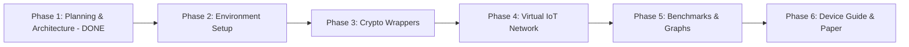
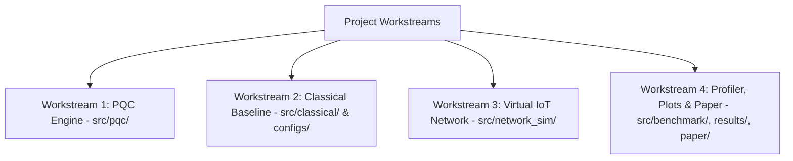
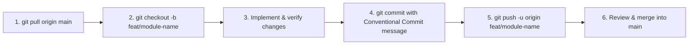

# 05 — Implementation Roadmap, Workstreams & Git Standards

> **Purpose of this document:** Provide a clear, phase-by-phase execution plan from planning through research paper completion, organized by technical module and professional Git conventions.

---

## 1. Six-Phase Project Roadmap

### Phase Breakdown & Verification Checkpoints

| Phase | Objective in Simple Words | Key Tasks | Completion Check |
| :---: | :--- | :--- | :--- |
| **Phase 1** *(Current)* | Finalize design before coding | Write structured docs, architecture flowcharts, metric controls, and directory blueprints | Complete planning docs & repository structure verified |
| **Phase 2** | Prepare reproducible lab environment | Set up Linux/WSL2 environment, Python venv, OpenSSL/`cryptography`, `liboqs` + `liboqs-python`, `Contiki-NG`/Cooja, `matplotlib` | Smoke checks verify `import oqs` (`ML-KEM`, `ML-DSA`) and Contiki build tools |
| **Phase 3** | Build modular crypto wrappers | Implement uniform wrappers in `src/classical/` (`RSA`, `ECDH`, `ECDSA`) and `src/pqc/` (`ML-KEM`, `ML-DSA`) | Correctness assertions pass for all security parameter sets |
| **Phase 4** | Integrate virtual IoT network & profiler | Build `src/network_sim/` (Contiki-NG + constrained link tests) and `src/benchmark/` (latency, CPU, RAM, size logging) | End-to-end dry run logs all 6 metrics cleanly into `data/` |
| **Phase 5** | Execute benchmarks & plot results | Run 50–100 repeated trials across security tiers, payload sizes, and link profiles; generate charts in `results/` | Reproducible CSV datasets + publication-quality Matplotlib figures |
| **Phase 6** | Deliver selection guide & manuscript | Finalize IoT Device-Tier Selection Guide and write full paper in `paper/` backed by measured figures | Complete manuscript & reproducible artifacts verified |

---

## 2. Module Workstreams

| Workstream | Directories | Core Deliverables |
| :--- | :--- | :--- |
| **Classical Crypto Baseline** | `src/classical/`, `configs/` | Uniform `RSA`, `ECDH`, and `ECDSA` wrappers plus security-level parity configs |
| **Post-Quantum Engine** | `src/pqc/` | `ML-KEM` and `ML-DSA` wrappers via `liboqs-python` with strict secret/signature validation |
| **Virtual IoT Simulation** | `src/network_sim/` | Contiki-NG / Cooja packet-fragmentation topologies and bandwidth/loss link profiles |
| **Benchmarking & Reporting** | `src/benchmark/`, `data/`, `results/`, `paper/` | Automated trial runner, memory/CPU profiler, Matplotlib charts, and manuscript |

---

## 3. Git Branching & Commit Standards

Follow a clean branching and Conventional Commits workflow so every change in `CNN-pqc` stays traceable and reviewable:

### Commit Message Convention
Use the `<type>(<scope>): <short summary>` format with an informative body explaining **what changed** and **why**:
- `docs(plan): ...` — Architecture, planning, or documentation updates
- `feat(pqc): ...` — New cryptographic wrapper or benchmark capability
- `fix(benchmark): ...` — Bug fixes in profiling, timing, or parsing
- `chore(repo): ...` — Tooling, `.gitignore`, dependencies, or config maintenance

### Repository Hygiene Rules
1. Keep `.gitignore` respected — never commit `__pycache__/`, virtual environments, compiled binaries (`.o`, `.elf`), or temporary logs.
2. Only store real, script-generated experimental datasets in `data/` and script-generated figures in `results/`.
3. Keep all code and documentation strictly scoped to the PQC-IoT evaluation project.
