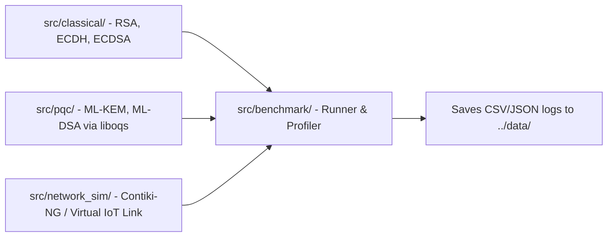

# `src/` — Planned Source Code Modules

> **Status:** Planning Stage Only — **No implementation code has been written yet.**

When Phase 3 and Phase 4 begin, this directory will hold clean, modular code organized by responsibility:

| Subfolder | Purpose in Later Phases |
| :--- | :--- |
| [`classical/`](classical/README.md) | Baseline RSA, ECDH, and ECDSA implementations using OpenSSL / Python `cryptography` |
| [`pqc/`](pqc/README.md) | Post-Quantum ML-KEM (FIPS 203) and ML-DSA (FIPS 204) wrappers using `liboqs-python` |
| [`network_sim/`](network_sim/README.md) | Contiki-NG / Cooja scripts and virtual constrained IoT network profiles |
| [`benchmark/`](benchmark/README.md) | Automated benchmark runner, CPU/RAM/latency profiler, and graph generator scripts |
