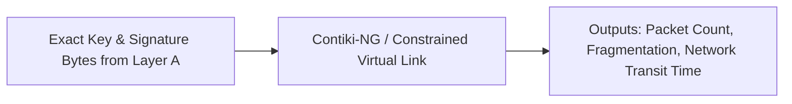

# `src/network_sim/` — Virtual IoT Network Simulation (Planned)

> **Status:** Blueprint only (Phase 4 deliverable).

## Planned Responsibility
Simulate realistic IoT network constraints without needing dozens of physical hardware devices.

## Planned Components
1. **Contiki-NG / Cooja Simulation Files:**
   - Virtual wireless IoT nodes sending handshake-sized payloads over IEEE 802.15.4 / 6LoWPAN links.
   - Measures packet splitting (fragmentation), transmission delay, and packet-loss behavior when larger PQC keys/signatures cross the radio channel.
2. **Constrained Link Emulation (Linux `tc` / Socket Testbed):**
   - Local client-server handshake over bandwidth-limited, delay-injected virtual links (e.g., 50 kbps, 250 kbps, 1 Mbps with 0%–5% packet loss).

